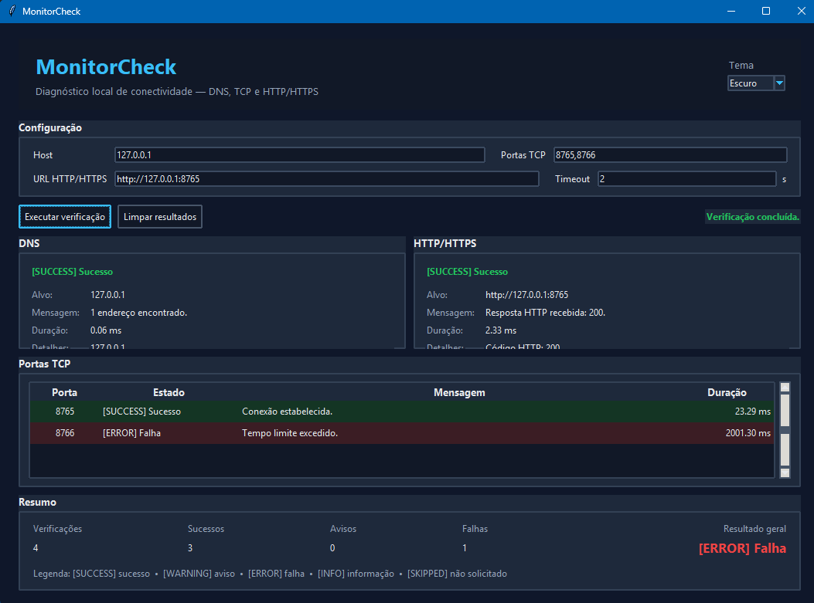
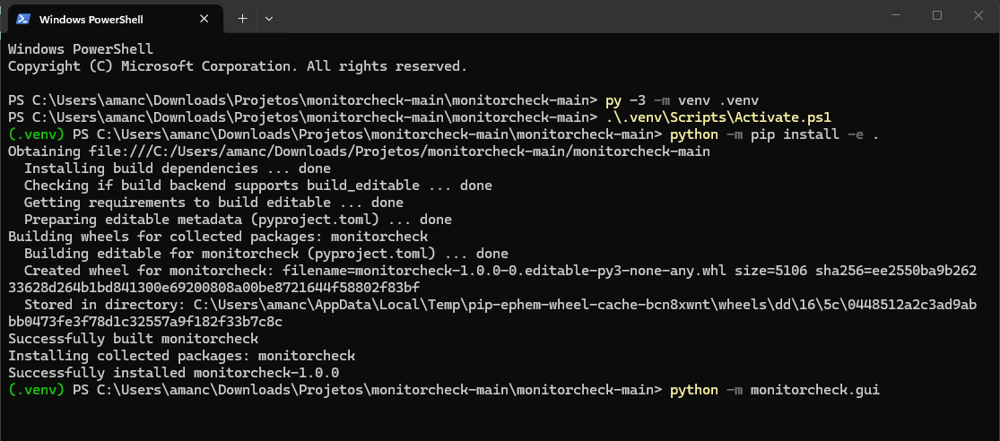

# MonitorCheck

MonitorCheck é uma aplicação acadêmica em Python para verificações básicas de
conectividade de hosts e serviços. O projeto oferece uma CLI e uma GUI local em
Tkinter, ambas apoiadas pelas mesmas validações, orquestração e verificações de
DNS, TCP e HTTP/HTTPS.

> Use o MonitorCheck apenas em hosts e serviços próprios ou para os quais exista
> autorização de teste.

## Demonstração

### Interface gráfica

O MonitorCheck possui uma interface gráfica local desenvolvida em Tkinter,
com temas Claro e Escuro e apresentação independente dos resultados de
DNS, portas TCP e HTTP/HTTPS.



## Objetivo

Reunir verificações simples de conectividade em uma aplicação pequena, legível
e sem dependências externas em tempo de execução. Cada operação produz um
`CheckResult` estruturado, independente da interface que o apresenta.

## Funcionalidades

- resolução DNS de endereços IPv4 e IPv6;
- remoção de endereços DNS duplicados em ordem determinística;
- testes sequenciais das portas TCP explicitamente informadas;
- distinção entre conexão bem-sucedida, recusada, timeout e erro de socket;
- requisição HTTP/HTTPS GET com validação TLS padrão;
- registro de código HTTP e URL final após redirecionamentos;
- tratamento controlado de erros HTTP, rede, timeout e TLS;
- duração individual das verificações;
- relatório da CLI com resumo, legenda, cores opcionais e códigos de saída;
- GUI responsiva com resultados separados para DNS, TCP, HTTP/HTTPS e resumo;
- execução das operações de rede fora da thread principal do Tkinter;
- temas Claro e Escuro, com troca imediata e tema Escuro inicial;
- validação compartilhada entre CLI e GUI.

## Requisitos

- Python 3.10 ou superior;
- `pip` e `setuptools` para instalação editável;
- suporte ao Tkinter para utilizar a GUI;
- nenhuma dependência externa em tempo de execução.

O Tkinter normalmente acompanha o Python no Windows e no macOS. Algumas
distribuições Linux o disponibilizam em um pacote separado do sistema.

## Instalação

### Windows PowerShell

```powershell
py -3 -m venv .venv
.\.venv\Scripts\Activate.ps1
python -m pip install -e .
```

### Linux ou macOS

```bash
python3 -m venv .venv
source .venv/bin/activate
python -m pip install -e .
```

A instalação editável cria o comando `monitorcheck`. Caso o diretório de
scripts do Python não esteja no `PATH`, utilize `python -m monitorcheck`.

### Instalação e execução

O projeto pode ser instalado localmente em um ambiente virtual Python.
Após a instalação editável, tanto a CLI quanto a interface gráfica ficam
disponíveis para execução.



## Execução pela CLI

```text
monitorcheck HOST [--ports PORTA,...] [--url URL] [--timeout SEGUNDOS] [--no-color]
```

Forma equivalente:

```text
python -m monitorcheck HOST [opções]
```

### Parâmetros

| Parâmetro | Obrigatório | Descrição |
| --- | --- | --- |
| `HOST` | sim | Nome de host, IPv4 ou IPv6 usado no DNS e nos testes TCP. |
| `--ports PORTA,...` | não | Portas TCP explícitas entre 1 e 65535, separadas por vírgulas. |
| `--url URL` | não | URL completa com esquema `http` ou `https`. |
| `--timeout SEGUNDOS` | não | Timeout positivo e finito para cada TCP e para HTTP. Padrão: `3`. |
| `--no-color` | não | Remove completamente as sequências ANSI da saída. |
| `-h`, `--help` | não | Exibe a ajuda da CLI. |

Portas repetidas são deduplicadas, preservando a primeira ocorrência. DNS é
sempre executado. TCP e HTTP/HTTPS só são executados quando `--ports` e `--url`
são fornecidos, respectivamente.

### Exemplos

Somente DNS:

```powershell
monitorcheck example.com
```

DNS e TCP:

```powershell
monitorcheck example.com --ports 80,443 --timeout 2
```

DNS, TCP e HTTPS:

```powershell
monitorcheck example.com --ports 80,443 --url https://example.com --timeout 3
```

Teste local sem cores:

```powershell
monitorcheck 127.0.0.1 --ports 8000 --url http://127.0.0.1:8000 --no-color
```

## Execução da GUI

```powershell
python -m monitorcheck.gui
```

A janela permite informar Host, Portas TCP, URL e Timeout. Durante uma
verificação, os campos e botões conflitantes ficam desabilitados, enquanto o
seletor de tema permanece disponível. Ao final, os controles são restaurados e
as seções apresentam os resultados estruturados.

O botão `Limpar resultados` restaura os painéis sem apagar a configuração. TCP
ou HTTP não solicitados aparecem como `SKIPPED`/não solicitados e não são
contabilizados como falha.

## Funcionamento das verificações

### DNS

Usa `socket.getaddrinfo` para consultar IPv4 e IPv6. Endereços duplicados são
removidos e as falhas do resolvedor são convertidas em resultado controlado. O
timeout configurado não substitui o timeout do resolvedor do sistema.

### TCP

Usa `socket.create_connection` para tentar uma conexão independente com cada
porta fornecida. As tentativas são sequenciais e utilizam o timeout configurado.
Não há varredura automática nem interpretação do protocolo da aplicação.

### HTTP/HTTPS

Usa `urllib.request` para executar GET sem consumir ou armazenar o corpo da
resposta. A verificação registra código HTTP, URL final e duração. HTTPS mantém
a validação padrão de certificados; certificados inválidos não são aceitos.

## Status e apresentação

| Status | Significado |
| --- | --- |
| `SUCCESS` | Verificação concluída com sucesso. |
| `WARNING` | Resposta disponível, mas inesperada ou parcial. |
| `ERROR` | Verificação falhou. |
| `INFO` | Informação neutra ou operação em andamento. |
| `SKIPPED` | Verificação não solicitada ou não executada. |

As cores são complementares: os rótulos textuais permanecem visíveis na CLI e
na GUI. Na CLI, `--no-color`, `NO_COLOR`, `TERM=dumb` ou saída não interativa
desativam ANSI.

## Temas da GUI

A GUI inicia no tema Escuro e oferece um seletor no cabeçalho para alternar
entre Escuro e Claro. A troca atualiza os widgets existentes sem limpar campos,
resultados ou uma execução em andamento. A escolha não é persistida após o
encerramento da aplicação.

## Códigos de saída da CLI

| Código | Significado |
| --- | --- |
| `0` | Nenhuma verificação terminou com `ERROR`; avisos não são falhas. |
| `1` | Pelo menos uma verificação terminou com `ERROR`. |
| `2` | Entrada inválida detectada pelo parser da CLI. |

## Testes

A suíte utiliza `unittest` e mocks. Os testes automatizados não dependem de
Internet, serviços externos ou display gráfico real.

```powershell
python -m compileall -q src tests
python -m unittest discover -s tests -v
python -m pip check
```

Sem instalar o pacote:

```powershell
$env:PYTHONPATH="src"
py -3 -m unittest discover -s tests -v
```

## Arquitetura resumida

```text
CLI ─┐
     ├─> validation.py
GUI ─┘
         |
         v
      runner.py
         |
         +--> DNS
         +--> TCP
         +--> HTTP/HTTPS
         |
         v
      CheckResult
```

- `cli.py`: argumentos, adaptação dos erros para `argparse` e relatório;
- `gui/`: interface Tkinter, temas e coordenação da thread de trabalho;
- `validation.py`: validação sintática compartilhada;
- `runner.py`: orquestração independente das interfaces;
- `models.py`: contratos compartilhados;
- `checks/`: lógica de DNS, TCP e HTTP/HTTPS;
- `presenters/terminal.py`: relatório, resumo e cores da CLI;
- `tests/`: testes unitários e de integração sem Internet real.

Mais detalhes estão em [docs/architecture.md](docs/architecture.md). O histórico
de implementação está em [docs/roadmap.md](docs/roadmap.md).

## Limitações conhecidas

- a resolução DNS depende do timeout do sistema operacional;
- TCP e HTTP são executados sequencialmente;
- somente portas explícitas são aceitas, sem intervalos ou descoberta;
- TCP confirma apenas o estabelecimento da conexão;
- o timeout HTTP não é um prazo global rígido para uma cadeia de redirecionamentos;
- HTTP/HTTPS suporta somente GET, sem autenticação ou cabeçalhos personalizados;
- não há ping ICMP, persistência, histórico, exportação ou monitoramento contínuo;
- não há banco de dados, API, interface web, Docker ou CI/CD;
- a aparência exata dos widgets pode variar conforme o Tk disponível no sistema.

## Escopo entregue

O projeto entrega CLI e GUI locais para DNS, TCP e HTTP/HTTPS, contratos e
validações compartilhados, relatório no terminal, resumo gráfico, execução
assíncrona da GUI e temas Claro/Escuro. A versão declarada atualmente é
`1.0.0`.

Commit, tag, release e publicação são etapas separadas e não são executadas
automaticamente pelo projeto.
